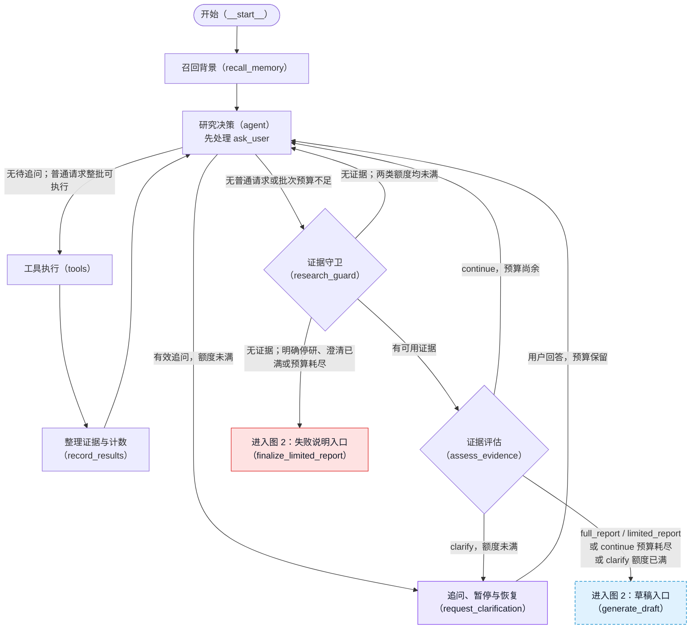
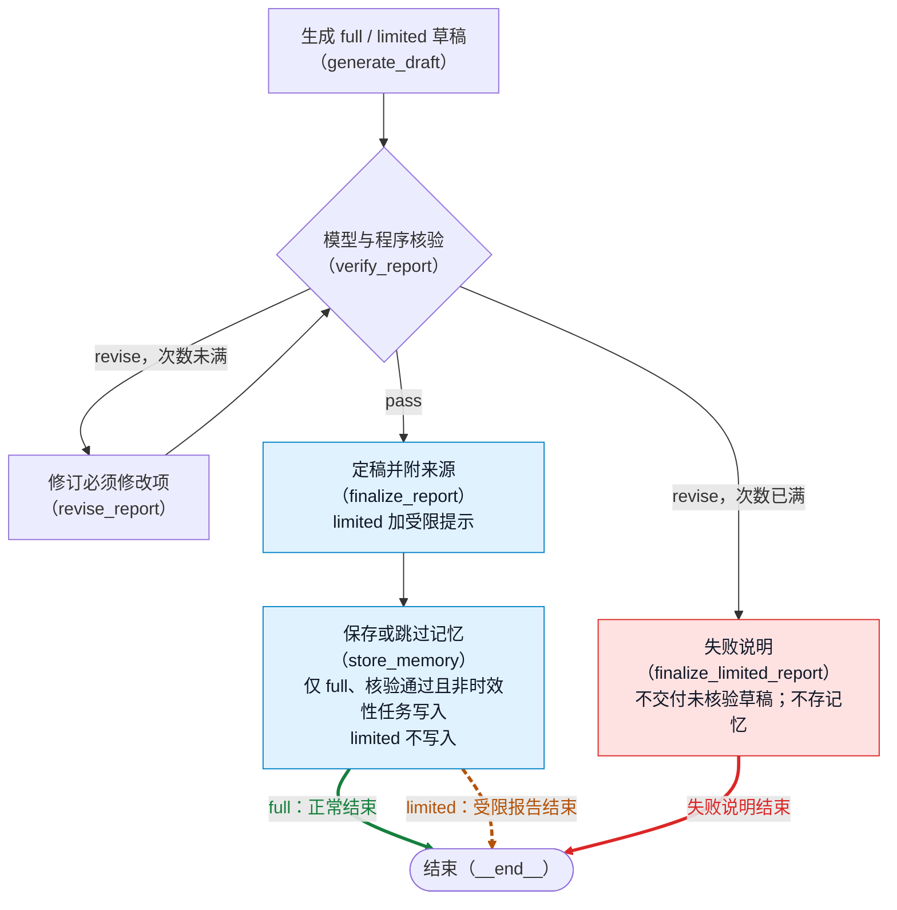

# Autonomous Research Agent

面向大气科学的证据驱动研究 Agent：用 LangGraph 工作流输出带来源的报告，缺证据时受限交付，无法可靠交付时说明失败。

## 它和普通搜索后总结有什么不同

一个面向大气科学领域的学习型 Research Agent。它的目标不是“搜索后直接总结”，而是
把问题、工具调用、证据、评估和带来源的报告串成一条可解释的 LangGraph 工作流。
它不把搜索摘要直接当证据，也不把模型自检当作事实认证；下面的设计取舍明确了取证、核验和交付边界。

## 五个设计取舍

### 证据与候选分离

`search_web` 只产生候选，网页须经 `read_source` 取得正文后才能成为证据，避免把摘要当作已读取的资料。用户陈述不是证据；本地一般机制不能证明具体事件，本地事件文献则须按原始出处区分观测、再分析与模拟。这些来源使用边界也通过提示词约束模型。见[事件取证与用户陈述](docs/architecture/research_workflow.md#事件取证与用户陈述)。

### 预算由程序控制

研究轮次、工具调用、修订、澄清和递归保护上限由 `settings.py` 常量决定，程序算好剩余预算再告诉模型，避免依赖模型自报额度。研究预算耗尽后基于已有证据转向交付，证据不足则受限交付或说明失败；递归超限另由入口捕获并说明中止，不保证生成报告。见[程序额度](docs/architecture/research_workflow.md#程序额度)与[配置常量](src/atmospheric_research_agent/agent/settings.py)。

### 分级核验

语义核验只把编造、与证据矛盾、引用不存在或错配、数字／单位／时间错误、证据冲突未说明列为必须修改；措辞偏强等只记建议、不因此拦截，避免反复改写却无法收敛。程序按必须修改项是否为空规范化 `verdict`，引用完整性与简要篇幅仍有程序硬检查，不能把模型判断视为独立事实认证。见[核验分级、复查与交付](docs/architecture/research_workflow.md#核验分级复查与交付)。

### 三种结束方式

正常报告、带程序提示的受限报告和失败说明分开交付，让用户区分“可支持的部分”与“未能可靠完成”。受限报告不写入长期记忆，避免把证据不全的结论固化为后续背景；失败说明也不存记忆。见[交付与记忆边界](docs/architecture/research_workflow.md#核验分级复查与交付)。

### 同任务追问恢复与可观测性

缺少关键信息时暂停追问，回答后在同一任务内保留状态与预算恢复，减少重新开始造成的重复取证。每次运行记录节点级 Trace，debug 模式实时追加节点序列；检查点仅在进程内有效，实时日志不等于可跨进程恢复。见[同任务暂停与恢复](docs/architecture/HITL_minimal.md)与[诊断材料](docs/architecture/research_workflow.md#--debug-诊断材料)。

## 一个真实排错案例

一次追问恢复后，流程因步数超限中止；补充诊断后才发现 Agent 无工具、证据评估要求继续的循环。
根因是有证据的空转未消费研究轮次；修复将此类空转计次，并把预算耗尽后的继续请求规范化为受限报告。
递归保护也按合法路径重新核算；Agent 为什么未调用工具仍未查清，见[定位、验证与遗留](docs/architecture/debug_log.md)。

## 输出示例

公开记录保留真实交付与被拦截的首稿，展示成功交付与失败边界，不代表总体成功率。

### 测试实录

两次真实运行展示了缺少关键条件时暂停追问用户并恢复，以及针对虚构气象站问题，核验环节拦下首稿中无证据支持的细节、修订后交付受限结论的过程。
查看[测试实录](docs/evidence/test_evidence_2026-10-20.md)，其中保留脱敏后的报告与完整 Trace，并说明已知局限。

## 快速开始

### 从 clone 到能跑

需要 Python >=3.11；以下使用 Windows PowerShell，在 clone 后进入项目目录：

```powershell
git clone https://github.com/Kasensill/autonomous-atmospheric-research-agent.git
cd autonomous-atmospheric-research-agent
py -3.11 -m venv .venv
.venv\Scripts\python -m pip install -e ".[dev]"
.venv\Scripts\python -m pytest --basetemp .pytest-tmp
.venv\Scripts\python -m atmospheric_research_agent.ingestion.build_index --dry-run
```

`dev` 是 `pyproject.toml` 定义的测试依赖组。安装依赖需要下载软件包；上述离线测试与 dry-run 不调用模型或研究 API。随后按[配置](#配置)填写凭据，建库后再运行研究。

| 能力 | 凭据要求 |
| --- | --- |
| 离线测试、知识资料 `--dry-run` 检查 | 不需要任何 key；需先安装依赖 |
| Agent、证据评估、报告生成／核验／修订 | `DEEPSEEK_API_KEY` |
| 本地向量建库、向量查询与 Rerank | `DASHSCOPE_API_KEY`；Rerank 专用地址按配置需要填写 |
| 网页候选搜索 | `TAVILY_API_KEY` |
| Open-Meteo 天气工具、HTML／PDF 来源读取 | 当前实现不需要 key，但需要联网；完整研究仍需模型凭据 |

离线测试不调用 API，不等于完整研究不需要 API。

### FastAPI 与 Streamlit 本地研究工作台

在项目根目录安装服务与界面依赖：

```powershell
.venv\Scripts\python -m pip install -e ".[api,ui]"
```

先在一个终端启动本地研究服务，再在另一个终端启动界面：

```powershell
.venv\Scripts\python -m atmospheric_research_agent.service
.venv\Scripts\python -m streamlit run streamlit_app.py --server.address 127.0.0.1
```

研究服务默认 `http://127.0.0.1:8000`（接口文档 `/docs`），浏览器界面为 `http://127.0.0.1:8501`。Streamlit 通过 HTTP 创建和查询任务，澄清回答恢复服务端同一张图，保留证据与已用预算；页面轮询不重复发起研究。进度按节点推进，不是模型逐字输出。

界面展示报告、证据、核验和 Trace，可下载 Markdown 与 JSON；支持上传 TXT、MD、文字型 PDF，并选择材料用途，追问恢复复用原材料。凭据在服务端本地 `.env` 配置，开始研究会调用配置的 API 并可能产生费用。报告完成后可继续提问，复用材料与有限历史背景，每轮独立取证和计算预算，见[本地服务说明](docs/architecture/local_service.md)。本版不支持 OCR 或多模态。

这是单用户、单worker、无排队的本地服务，一次只接收一个未结束任务。页面刷新后可从任务列表重新选择；服务重启则内存任务丢失。可放弃等待中的任务，不支持强停运行中的任务；底层调用卡死时可能需要重启。长期记忆仍共用本地文件，不提供多用户隔离。接口契约、错误、记录保留与测试边界见[本地服务说明](docs/architecture/local_service.md)。离线接口测试不等于真实网络与模型端到端验收。

## 完整流程图

### 当前状态：研究闭环、报告核验与同任务 HITL 已实现

当前能力统一入口如下；项目仍用于学习，不应被视为科学结论生产系统或天气预警系统。

- 证据驱动研究：工具结果整理为正式证据，报告以证据编号注明来源。
- 同任务追问恢复：缺少关键条件时暂停等待回答，在同一进程中保留状态与预算继续研究。
- 分级核验与修订：模型区分必须修改项与建议，程序检查引用并限制修订次数。
- 受限报告：证据不足时只交付可支持的部分，核验失败则输出失败说明而非未核验草稿。
- 程序化预算：研究轮次、工具调用与澄清额度由程序控制，并为无工具空转计次。
- 可观测性与排错记录：Trace、实时节点日志和超限诊断帮助定位问题，排错结论见[排错记录](docs/architecture/debug_log.md)。
- 运行时材料：CLI、FastAPI 与 Streamlit 支持 TXT、MD、文字型 PDF，按线索或分析对象使用，标注未独立核实与覆盖范围；含材料的运行不入长期记忆，见[材料模块](docs/architecture/materials.md)。

### 图 1：研究与追问



图 1 的两个出口沿用真实节点 ID：`generate_draft` 对应图 2 的草稿入口，`finalize_limited_report` 对应图 2 的失败说明入口，不是新增节点。`tools` 合并执行四个研究工具：本地检索、当前天气、网页搜索、HTML／文字层 PDF 读取；`ask_user` 不在其中。有效追问优先；超限或参数无效的追问不取消同批普通工具，普通工具仍检查预算。

### 图 2：报告核验与结束



绿色实线为 full 正常结束，橙色虚线为 limited 受限报告结束，红色实线为失败说明结束。full 与 limited 共用 `finalize_report → store_memory → END`；双色结束线仅展示结果区别，不是新增路由。limited 经过记忆节点但跳过写入，失败说明不经过记忆节点。

完整分支说明、预算与暂停恢复机制见[当前研究流程图](docs/architecture/research_workflow.md)。

## 可用工具

- `search_local_knowledge(query)`：本地知识库的向量召回 + BM25 + RRF + Qwen Rerank。
- `get_current_weather(location)`：通过 Open-Meteo 获取指定地点的模型当前条件。
- `search_web(query)`：通过 Tavily 寻找公开网页候选；候选摘要不是正式证据。
- `read_source(url)`：读取候选网页正文与可获得的标题、机构、作者、日期。

`read_source` 支持有文字层的 PDF（有页数、大小、字符上限），不做 OCR；限制与失败提示见架构文档的 PDF 一节。

只有本地知识片段、天气规范化结果和实际读取到的网页正文会写入 `evidence`。网页搜索
结果仅供 Agent 选择下一步读取哪些 URL。

知识库 Markdown 中的“资料来源”“参考资料”“参考文献”小节会保留在原文件中供人类
追溯，但不会作为可检索 Chunk 进入 Chroma 或 BM25，避免书目列表污染知识候选。

## 项目结构

```text
data/
  knowledge_base/                 # 57 篇知识摘要、授权原文与诊断清单
  vector_store/                   # Chroma 运行数据（不提交）
src/atmospheric_research_agent/
  ingestion/build_index.py        # Markdown → 分块 → Embedding → Chroma
  agent/
    state.py                       # ResearchState：图中的共享公共契约
    settings.py                    # 预算、Top-K、超时等集中运行配置
    nodes.py                       # Agent、工具、证据、评估、报告节点
    graph.py                       # 节点和边组成的 LangGraph
    run.py                         # 命令行入口
    tools/                         # 四个实际工具
tests/                             # 单元测试与图流程测试
examples/                          # Tool Calling 学习示例
```

## 配置

复制 `.env.example` 为 `.env`，填写所需密钥；`.env` 不应提交。

```text
DEEPSEEK_API_KEY=             # 运行 Agent、证据评估、报告生成
DASHSCOPE_API_KEY=            # 建库和本地向量查询
# 可选：qwen3.7-text-rerank 需要业务空间专用地址时再填写
DASHSCOPE_RERANK_BASE_URL=
TAVILY_API_KEY=               # 公开网页搜索；不使用网页搜索时可不填
```

`agent/settings.py` 集中维护不会交给模型修改的在线运行规则，例如研究轮次、工具调用
上限、本地检索 Top-K、网页读取长度和网络超时。离线入库的分块参数留在
`ingestion/build_index.py`，因为它是独立的数据准备流程。

DeepSeek 的 Agent Tool Calling 明确关闭思考模式：该 API 模式要求每轮回传专有的
`reasoning_content`，而项目以可审阅的 State、工具结果与节点轨迹记录研究过程，不依赖
隐藏思维链。

## 从知识库到向量库

先运行不消耗 API 的资料检查：

```powershell
.venv\Scripts\python -m atmospheric_research_agent.ingestion.build_index --dry-run
```

确认后重建本地 Chroma collection：

```powershell
.venv\Scripts\python -m atmospheric_research_agent.ingestion.build_index --reset
```

### 原文语料与增量更新

2026-10-25 的语料深化后共 57 篇、515 个片段：替换五篇核心提纲为可追溯的英文原文选段，新增四份项目诊断清单和两篇郑州／河南暴雨事件文献。原文采用公版或 CC BY，具体作者、版本、许可、页范围与文件摘要见[来源清单](data/corpus_sources.json)。稳定边界层综述、北美低空急流模拟和旧版基础教材各有范围限制，不是完整覆盖所有地区的统一教材。诊断清单是项目编写的方法参考，不是外部原文或事件证据。

需要重新从 PDF 提取时，先安装 `pip install -e ".[corpus]"`，按来源清单取得原件，再使用 `ingestion.import_sources` 的 `--manifest`、`--raw-dir` 参数。原始 PDF 保留在被忽略的 `docs/validation/` 日期目录，勿直接提交；导入器校验摘要，保留 PDF 页序，不做 AI 改写或 OCR，图表及二维公式需回原 PDF 核对。

已有索引更新可使用下面的入口（会发送变化片段到配置的 DashScope 并产生 Embedding 费用）：

```powershell
.venv\Scripts\python -m atmospheric_research_agent.ingestion.sync_index
```

它先备份旧向量与 BM25，复用正文未变的向量，准备变化片段和新 BM25 后写库，清理不在当前语料中的旧 ID；不删除 collection。成功后核对两套 ID、正文与元数据，写库异常时用备份尝试回滚。它不是跨文件数据库事务，更新期间勿并发研究或建库。备份与摘要位于已忽略的 `docs/validation/<日期>/corpus-expansion/`。本次实际同步为 204→515 条，新增／变化向量 331 条、复用 184 条；随后已完成两层定向对照评测：检索20题中12题提高、6题持平、2题下降；固定证据回答10题新旧各重复2次，均分7.10→7.70/8。公式补全仍有待复核项，不作全面通过结论。见[本次语料评测](docs/evidence/evaluation_summary_2026-10-25.md#10-语料扩充两层对照2026-10-25)。

## 运行研究

完整交互入口，首次问题与澄清回答均由用户输入，调用真实模型和工具：

```powershell
.venv\Scripts\python examples/05_interactive_research.py
```

正式模块入口也支持追问后继续：缺少地点等必要信息时会在当前终端等待回答，不需要重新发起任务。
HITL 使用 `InMemorySaver`、不变的 `thread_id`、`interrupt()` 和 `Command(resume=...)`。
恢复保留证据、消息、记忆、研究轮次与工具计数；回答追加到消息和澄清记录，传给评估、写作与核验。
人工等待时间不计入执行耗时。退出进程后不能恢复；尚未加入 SQLite、前置意图节点或旧证据自动筛选。
设计与验证详情见 [最小 HITL 说明](docs/architecture/HITL_minimal.md)。

只使用内部知识库：

```powershell
.venv\Scripts\python -m atmospheric_research_agent.agent.run "为什么副热带高压会带来高温少雨？请仅查询内部知识库，并给出带来源的研究结论。" --debug
```

混合使用内部知识库与公开来源：

```powershell
.venv\Scripts\python -m atmospheric_research_agent.agent.run "为什么副热带高压常带来高温少雨？请同时使用内部知识库和至少一个来自大学、政府气象机构或权威百科的公开网页来源；不要使用社交媒体或商业天气 API 首页，并给出带来源的研究结论。" --debug
```

`--debug` 会显示研究轮次、工具调用数、正式证据数与节点轨迹，适合学习图实际如何运行。

## 测试与证据

已有记录按版本与测试性质分开统计；本摘要整理于 2026-10-25；历史修复批次未重新运行，新增语料两层对照单列如下。

| 层次 | 已有结果 | 结论边界 |
| --- | --- | --- |
| 语料扩充两层对照 | 检索20题：12提高、6持平、2下降；固定证据40份首稿，均分7.10→7.70/8 | 开发题集、执行AI评分；噪声增加，公式补全风险待复核；不含完整Agent |
| 本地服务收尾（2026-10-27） | **443项离线测试通过，无跳过或排除**；标准接口、页面测试与假节点真实TCP冒烟通过 | 不代表真实模型报告质量；详见[服务验证边界](docs/architecture/local_service.md#验证) |
| 历史离线回归 | **425 通过、0 失败、0 跳过**；对应修复提交 `0add4d9` 的源码 | 程序契约验证，不是报告准确率；运行发生于提交前 |
| 历史冻结版 B | 25 题 **23 通过、2 失败**；三组题各累计 3 次重复 | 含两题按预期暂停；不是当前版 25 题重跑或盲测 |
| 修复后定向回放 | 日期／停研说明、过期天气说明、超长输入单句输出，各 **2 次有效复测**符合目标 | 原失败保留；另有两次装置漏装资料，未计目标通过 |
| 核验分辨力 | 冻结 B 的 16 稿：8 坏稿拦截、8 好稿放行 | 模型＋程序的复合结果，小型自建集 |
| 历史真实工具链路 | 本地检索、网页、天气各 1 次完成 | 曾发现内容越界并另行修复，未重跑全部新版外部链路 |

[查看完整测试证据报告](docs/evidence/evaluation_summary_2026-10-25.md)：包含历史检索对比、逐批版本、失败与修复对账、实际输出节选、证据文件摘要和未验证项。原始运行产物仅本地保存；公开汇总不能替代原始包或独立领域验收。

离线复现命令（不调用研究 API）：

```powershell
.venv\Scripts\python -m pytest --basetemp .pytest-tmp
```

## 当前边界与版本路线图

- 本地检索已升级为 **向量召回 + 中文 BM25 + RRF + qwen3.7-text-rerank**；
  检索排名只表示问题与片段的相关性，不等于来源可信度。当前语料为 515 个可检索
  知识 Chunk（2026-10-25 资料切分及实际向量／BM25 同步核对；定向评测结果见上文）。缺少专题资料时应生成受限结论，而不是外推为完整结论。
- 当前已有检索与报告核验评测，以及按 ``run_id`` 关联的节点 Trace、耗时和业务事件；它们仍是
  本地命令行可读版本，尚未接入数据库、监控平台、告警或成本仪表盘。
- 网页正文读取具有 V1 基础的 URL 安全过滤；不等于生产级的全量 SSRF 防护。
- 当前 Task Memory 只保存已通过核验报告的项目摘要，并按轻量词项召回；它是跨运行背景，绝不是
  本次可引用的正式 evidence，也尚未实现数据库或跨用户隔离。任务恢复另由内存检查点负责，不能跨进程。

### 历史修复与质量验证

历史的离线通过数、检索指标、核验与端到端验收已统一整理到[完整测试证据报告](docs/evidence/evaluation_summary_2026-10-25.md#7-历史检索与早期基线不冒充当前成绩)，避免把阶段成绩误当当前结果。2026-10-20 的设计与逐条改进仍见[改进记录](docs/architecture/output_review_2026-10-20.md)；公开问答与 Trace 见[测试实录](docs/evidence/test_evidence_2026-10-20.md)。

### 核心实现顺序

当前确定的核心 Agent 学习与实现顺序如下。每一阶段都建立在前一阶段已经可运行、可观察的基础上，
避免为了堆叠概念而过早引入复杂架构：

1. **V1.6：检索评测与数据补强（已完成）**：固定问题集对比纯向量、RRF、RRF + Rerank 的召回质量，
   并根据评测补充了低空急流等专题资料。
2. **V2：Reflection / Verification（已完成）**：报告先生成草稿，再由结构化审查与程序引用完整性检查共同
   决定定稿、受控修订或安全降级；另有最小人工标注评测集。
3. **V2.1：Task Memory 与 Observability（第一版已完成）**：每次运行有 run_id、Trace、节点耗时与总耗时；
   完整且非时效性、已通过核验的报告摘要会保存为本地项目记忆，并在后续相关任务开始时作为背景召回。
   **HITL 增量（2026-10-20）**：两个澄清入口接入同任务暂停恢复；证据评估的澄清必须提供具体追问。
   历史机制验收与当前回归分别记录于[测试证据报告](docs/evidence/evaluation_summary_2026-10-25.md)，不证明模型永不重复提问、数据永不过期或报告科学结论绝对正确。
4. **V3：Multi-Agent（规划中，未实现）**：此前按 Coordinator / Planning、Research、Evidence Review、
   Report Writer、Report Verification 五类职责描述；具体拆分以[三 Agent 规划](docs/architecture/V3_three_agent_plan.md)为准，
   不表示当前已实现子 Agent。Event/Data Agent 属于后续事件研究方向的可插拔扩展，不替代这条近期主线。

MCP、FastAPI、Docker 与前端属于服务和产品交付层：它们会复用稳定的 `run_research()` 核心入口，
但不抢在上述核心能力之前实现。

### 远期能力地图

**核心能力之后的高级能力地图**

当单 Agent、Reflection、任务记忆和职责明确的 Multi-Agent 已稳定后，后续能力按以下方向扩展。
它们不是另一套脱离基础的知识，而是把同样的 State、节点、边、工具与评测能力扩展到更可靠的生产系统。

- **评测与可观测性**：固定问题集、期望证据、检索与报告质量指标、耗时和成本记录；不能只凭单次回答观感判断质量。
- **持久化与可恢复运行**：将 State、检查点、研究记录写入数据库，使中断任务可以从最近节点恢复。
- **Human-in-the-loop**：在关键来源、研究计划或最终结论处暂停，等待人工确认后继续。
- **可靠工具系统**：权限分级、参数校验、超时、重试、幂等性与沙箱；工具开始涉及文件、代码或外部写操作时尤其关键。
- **长期与异步任务**：以后台任务、队列和进度状态支持分钟到小时级研究，并允许查看、取消和恢复。
- **分层 Memory**：从任务记忆扩展到用户偏好和项目知识；每层都要明确记忆写入、检索、过期与影响决策的规则。
- **更严格的验证器**：检查引用是否真实支撑主张、来源是否冲突、是否有过度推断，而不只检查是否存在引用。
- **高级 Multi-Agent 协作**：并行研究、辩论、投票、协调与任务分配；拆分必须用评测证明其质量或效率收益。
- **Graph RAG 与结构化知识**：资料中的实体与关系需要多跳推理时，再引入图谱，而不是替换已经有效的文本检索。
- **多模态 Agent**：读取天气图、卫星云图、PDF 表格、雷达图等非纯文本证据。
- **部署与产品化**：FastAPI、MCP、Docker、前端、认证、限流、日志、监控与成本控制。

SFT、LoRA、DPO、RLHF 等模型训练技术属于并行但更偏模型层的路线。只有在提示、工具、检索与工作流
优化仍无法稳定解决某类问题时，才作为后续投入方向；当前不影响本项目的 Agent 工程主线。
