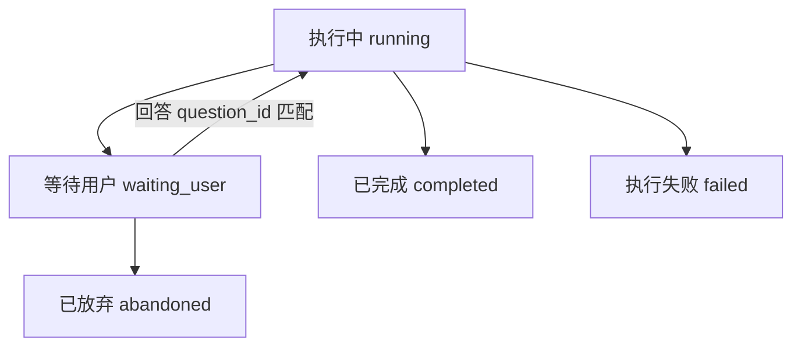

# 本地 FastAPI 研究服务

这是单用户、单任务的服务化首版。FastAPI 管理 HTTP 请求与任务记录；独立执行线程驱动原有同步 LangGraph。研究节点、路由、提示词与程序预算未因本次服务化改变。

## 启动

在项目根目录安装可选依赖：

```powershell
.venv\Scripts\python -m pip install -e ".[api,ui,dev]"
```

第一个终端启动服务：

```powershell
.venv\Scripts\python -m atmospheric_research_agent.service
```

第二个终端启动界面：

```powershell
.venv\Scripts\python -m streamlit run streamlit_app.py --server.address 127.0.0.1
```

研究服务为 `http://127.0.0.1:8000`，接口文档为 `/docs`；界面为 `http://127.0.0.1:8501`。如需更改界面连接地址，可在启动界面的终端设置环境变量 `RESEARCH_API_URL`；首版客户端仅接受本地 HTTP 地址，不读取该变量的 `.env` 配置。模型与工具凭据仍由研究进程读取本地 `.env`，网页不提交凭据。

固定服务启动器只绑定 `127.0.0.1`，一个 worker，不启用 reload。不要用多个 worker 或热重载承载这些内存任务。原 CLI 仍可独立使用，但不要与服务并行运行研究或更新索引，二者仍共用本地索引与长期记忆文件。

## 执行与状态



只允许一个 `running` 或 `waiting_user` 任务；没有队列。等待用户仍占任务名额，但不占执行线程。其他创建返回409，可等待完成或主动放弃等待中的任务。运行中的任务不能强制取消。关闭页面不会主动取消后台执行；刷新后可从服务端任务列表重新选择。

`delivery_type` 与 `status` 独立：只有正常完成才为 `full_report`、`limited_report` 或 `failure_notice`，其他状态为 null。失败说明是完成后的交付类型，不是执行异常。澄清恢复继续原图、run_id 和预算，上传材料也沿用同一检查点；报告完成后可通过继续提问创建新的研究任务，共享 conversation_id，parent_run_id 指向直接上一轮；不复活旧图。

任务记录默认最多20条，满时创建新任务会清理最早登记的终态记录及其幂等映射；活动任务不被清理。完成、失败或放弃时删除图检查点并释放图引用，保留可查询的结果和必要记录。没有自动过期、持久队列或跨进程恢复。服务重启后这些任务全部丢失；保留记录只用于当前进程，不是历史档案。

## 接口契约

| 方法与路径 | 行为 |
| --- | --- |
| `GET /health` | 检查服务可访问；不调用模型，不证明凭据有效，也不是线程卡死探针 |
| `POST /runs` | JSON `question`，必须有 `Idempotency-Key` 头；接受后返回202与任务快照 |
| `POST /runs/with-materials` | multipart 的 `question`、`material_role`、重复 `files`；必须有同一幂等请求头；保存文件后创建同类研究任务 |
| `GET /runs` | 返回最多20条保留任务，最近登记在前，不返回完整正文 |
| `GET /runs/{id}` | 状态、交付类型、预算、version、updated_at、当前追问与安全错误 |
| `POST /runs/{id}/follow-ups` | JSON `question`、可选 `material_role`（默认auto），必须有幂等头；已完成任务的新提问返回202与独立任务 |
| `POST /runs/{id}/answers` | JSON `question_id`、`answer`；匹配待答问题后返回202 |
| `POST /runs/{id}/abandon` | 只放弃等待回答的任务，立即释放执行名额 |
| `GET /runs/{id}/result` | 已完成时返回报告、证据、核验与补充记录；不公开内部模型消息、记忆或草稿 |
| `GET /runs/{id}/trace` | `after`为已读序号（默认0），`limit`默认100、最大500；返回events、next_after、has_more |

问题与回答限制为非空文本、最多10000字符。创建标识为1–128个ASCII字母、数字或`._:-`，前端使用UUID。未知请求字段被拒绝。version随发布的进展和状态转换递增；updated_at为UTC时间。Trace序号从1开始，游标只在当前任务内有效。

创建时，同key同问题及相同材料输入返回原任务；同key不同问题、材料内容、文件名、顺序或用途返回409。规范化仅去除问题首尾空白，不合并或猜测问题语义。幂等有效期与内存记录一致，记录被清理或服务重启后不再保证复用。HTTP客户端不自动重试；界面对未确认的同一次创建保留请求标识。

上传支持 TXT、MD、文字型 PDF；数量与大小上限在 settings 中集中定义，超大小返回413。仅接受文件名，不接受服务端路径；保存到已忽略的 `tmp/material_uploads/`，不返回保存路径、不自动清理原文件。解析复用材料模块，在后台线程执行；回答追问不再次上传或解析。快照增加 `material_files` 与 `material_role`，最终结果的 `state` 增加 `materials` 覆盖摘要。来源和记忆规则见[材料说明](materials.md)。

每次进入等待状态只生成一次question_id，轮询不更换。回答的状态检查、ID检查和执行资格变更在同一锁内完成；重复、旧ID和非等待状态返回409。锁内不运行模型、不等待Future。接口读取发布后的深复制快照，不查询执行中的图；只有执行方访问图状态。

错误统一为`code`、`message`、`run_id`、`error_id`。参数不合法422；任务不存在或已清理404；忙、结果未就绪、重复回答或已放弃409；服务关闭/提交失败503。执行失败的result返回409及可关联error_id，不假装有报告。404/参数错误等无法关联有效任务时run_id可以为null。

运行错误日志记录run_id、error_id、异常类型和代码位置，主动省略异常消息、局部变量、绝对路径及模型正文，客户端不接收异常原文。现有依赖自身可能输出日志，不能将此描述为已审计所有第三方日志。报告、证据与Trace可能含研究内容；该服务没有用户认证或跨用户隔离，不用于公网部署。

## 执行边界

一条后台线程同步执行图；普通异常被捕获，任务转failed并释放位置。服务关闭时拒绝新任务并释放暂停图，运行中的线程不会被假装杀死。底层调用卡死时仍可能需要终止服务进程，正常退出也可能等待该调用。

当前模型客户端沿用原配置，未在本次新增统一调用超时或重试规则；网页/天气/PDF等调用各沿用原有实现。图预算和递归上限不是墙钟硬超时。本版不承诺硬取消、超时后自动恢复服务或自动重试失败研究。

## 验证

```powershell
.venv\Scripts\python -m pytest tests/test_service.py tests/test_service_api.py tests/test_service_client.py
.venv\Scripts\python -m pytest
```

管理层测试覆盖并发创建/回答、重复标识冲突、状态冲突、异常释放、放弃及记录清理。接口测试通过内存ASGI请求实际经过FastAPI校验与路由，并用真实LangGraph interrupt配合假节点验证恢复；没有模型调用或记忆写入。内存驱动仅允许这些不挂起的内存接口，不能替代真实事件循环或TCP验收。

标准TestClient与Streamlit AppTest另行验证生命周期和界面；若本机回环TCP预检失败则明确跳过，避免Windows事件循环创建socketpair时无限等待。必须查看测试的skip信息，不能将跳过算通过。真实模型与浏览器验收需另外执行并记录结果。

2026-10-27收尾验证：完整离线回归443通过、0跳过、0排除；标准TestClient、Streamlit AppTest和异步恢复用例实际执行通过。另用临时Uvicorn与假研究节点完成真实本机TCP创建、暂停、恢复、结果和Trace查询，重复回答返回409。该验证不调用模型，不证明研究报告的科学质量。此前三条旧断言/标注已与当前语料结构和来源范围对齐；迁移后的旧12题正标签集合已变，不能把历史检索指标直接当作新标注下的对照成绩。

## 报告后的继续提问

Streamlit 在完成报告下方提供“继续提问”。每轮有新的 run_id、研究图、检查点及完整预算；父任务保持可查询（受20条历史记录上限约束）。正在等待的澄清必须走原 answers 接口，失败或放弃的任务不能作为继续提问入口。服务仍一次只允许一个未结束任务。

继续提问复用父任务状态中已解析并送入过的材料片段及覆盖信息，不再保存或解析文件，不尝试读入上轮未覆盖部分；材料用途根据本轮问题重新判定，也可显式选择。更换文件请新建研究。复用材料不会继承网页证据、原消息、旧预算或旧核验结论。

历史背景最多取最近4轮，包含问题、补充问答、交付类型及报告；按最近轮次优先，合计保留最多12000字符（JSON数据文本，不含提示规则与外层封装）。超限文本截断并标记 truncated，背景在 result 的 conversation_context 中可检查；对应上限见 settings 的 CONVERSATION_CONTEXT_MAX_TURNS 与 CONVERSATION_CONTEXT_MAX_CHARACTERS。它们是可调上下文限额，不是研究预算。被截断内容不能假装已读取。

背景独立于 evidence，规划、评估、写作、核验与修订输入均标为历史数据。旧报告可能出错，旧 E 编号不能沿用；具体事实需要本轮重新取证。这是程序隔离加模型规则，不能仅凭离线测试断言真实模型始终正确归因。历史内容不构成读取本地路径或改变工具权限的授权。

幂等校验同时检查父 run_id、问题和材料用途。同一继续请求重发会复用新任务；改变父任务或用途返回409。会话标识与背景只在内存中保留，父记录被清理后不能再从该轮创建分支；仍保留的子任务有自己的材料及背景快照，可以继续。服务重启后不能恢复会话，不新增数据库或持久检查点。
