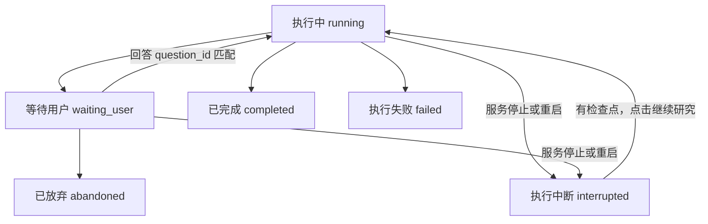
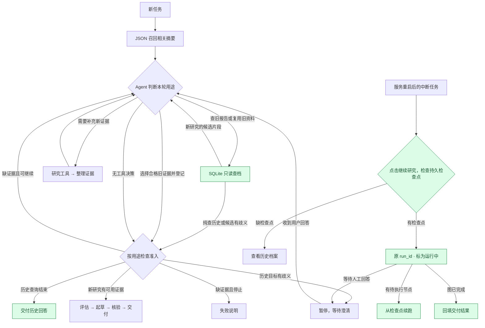

# 本地 FastAPI 研究服务

这是单用户、单任务的本地服务。FastAPI 管理 HTTP 请求，SQLite 保存任务档案，独立执行线程驱动原有同步 LangGraph。研究节点、路由、提示词与程序预算未因持久化改造改变。

## 启动

在项目根目录安装可选依赖：

```powershell
.venv\Scripts\python -m pip install -e ".[api,ui,dev]"
```

第一个终端启动服务：

```powershell
.venv\Scripts\python -m atmospheric_research_agent.service
```

第二个终端启动界面：

```powershell
.venv\Scripts\python -m streamlit run streamlit_app.py --server.address 127.0.0.1
```

研究服务为 `http://127.0.0.1:8000`，接口文档为 `/docs`；界面为 `http://127.0.0.1:8501`。如需更改界面连接地址，可在启动界面的终端设置环境变量 `RESEARCH_API_URL`；首版客户端仅接受本地 HTTP 地址，不读取该变量的 `.env` 配置。模型与工具凭据仍由研究进程读取本地 `.env`，网页不提交凭据。

固定服务启动器只绑定 `127.0.0.1`，一个 worker，不启用 reload。执行图仍在进程内；不要使用多个 worker 或热重载。同一数据库的第二个服务实例会被拒绝启动，避免把仍在运行的任务误判为重启中断。原 CLI 仍可独立使用，但不要与服务并行运行研究或更新索引，二者仍共用本地索引与长期记忆文件。

## 执行与状态



只允许一个 `running` 或 `waiting_user` 任务；没有队列。等待用户仍占任务名额，但不占执行线程。其他创建返回409，可等待完成或主动放弃等待中的任务。运行中的任务不能强制取消。关闭页面不会主动取消后台执行；刷新后可从服务端任务列表重新选择。

`delivery_type` 与 `status` 独立：只有正常完成才为 `full_report`、`limited_report` 或 `failure_notice`，其他状态为 null。失败说明是完成后的交付类型，不是执行异常。澄清恢复继续原图、run_id 和预算，上传材料也沿用同一检查点；报告完成后可通过继续提问创建新的研究任务，共享 conversation_id，parent_run_id 指向直接上一轮；不复活旧图。

任务档案默认保存在项目内 `data/runtime_service/research.sqlite3`，路径由 settings 的 `SERVICE_DATABASE_PATH` 指定，数据库、日志及实例锁文件所在目录均被 Git 忽略。档案使用 Python 内置 sqlite3。执行检查点由 langgraph-checkpoint-sqlite 保存。任务快照、最终报告、证据、Trace、材料片段与覆盖、会话关联、幂等标识在事务内保存。内存最多缓存20条任务，超限仅移出内存，不删除数据库历史或幂等映射；按原任务 ID 仍可读取。完成、失败、放弃时释放图引用。磁盘检查点随任务档案保留。档案没有自动过期或自动删除。

## 接口契约

| 方法与路径 | 行为 |
| --- | --- |
| `GET /health` | 检查服务可访问；不调用模型，不证明凭据有效，也不是线程卡死探针 |
| `POST /runs` | JSON `question`，必须有 `Idempotency-Key` 头；接受后返回202与任务快照 |
| `POST /runs/with-materials` | multipart 的 `question`、`material_role`、重复 `files`；必须有同一幂等请求头；保存文件后创建同类研究任务 |
| `GET /runs` | 分页读取任务摘要：limit 默认20、最大100，offset 默认0；可按 conversation_id 筛选；最近登记在前，不返回完整正文 |
| `GET /runs/{id}` | 状态、交付类型、预算、version、updated_at、当前追问与安全错误 |
| `POST /runs/{id}/follow-ups` | JSON `question`、可选 `material_role`（默认auto），必须有幂等头；已完成任务的新提问返回202与独立任务 |
| `POST /runs/{id}/resume` | 继续已中断且存在检查点的任务。成功排入执行器后返回 202，状态冲突返回 409 |
| `POST /runs/{id}/answers` | JSON `question_id`、`answer`；匹配待答问题后返回202 |
| `POST /runs/{id}/abandon` | 只放弃等待回答的任务，立即释放执行名额 |
| `GET /runs/{id}/result` | 已完成时返回报告、证据、核验与补充记录；不公开内部模型消息、记忆或草稿 |
| `GET /runs/{id}/trace` | `after`为已读序号（默认0），`limit`默认100、最大500；返回events、next_after、has_more |

问题与回答限制为非空文本、最多10000字符。创建标识为1–128个ASCII字母、数字或`._:-`，前端使用UUID。未知请求字段被拒绝。version随发布的进展和状态转换递增；updated_at为UTC时间。Trace序号从1开始，游标只在当前任务内有效。

创建时，同key同问题及相同材料输入返回原任务；同key不同问题、材料内容、文件名、顺序或用途返回409。规范化仅去除问题首尾空白，不合并或猜测问题语义。幂等标识与任务一同持久保存，重启后相同请求仍复用原 run_id，失败、中断、放弃的原请求也不会自动重跑。HTTP客户端不自动重试；界面对未确认的同一次创建保留请求标识。

上传支持 TXT、MD、文字型 PDF；数量与大小上限在 settings 中集中定义，超大小返回413。仅接受文件名，不接受服务端路径；保存到已忽略的 `tmp/material_uploads/`，不返回保存路径、不自动清理原文件。解析复用材料模块，在后台线程执行；回答追问不再次上传或解析。快照增加 `material_files` 与 `material_role`，最终结果的 `state` 增加 `materials` 覆盖摘要。来源和记忆规则见[材料说明](materials.md)。

每次进入等待状态只生成一次question_id，轮询不更换。回答的状态检查、ID检查和执行资格变更在同一锁内完成；重复、旧ID和非等待状态返回409。锁内不运行模型、不等待Future。接口读取发布后的深复制快照，不查询执行中的图；只有执行方访问图状态。

错误统一为`code`、`message`、`run_id`、`error_id`。参数不合法422；任务不存在404；忙、结果未就绪、重复回答、已放弃或执行中断409；服务关闭、提交失败或存储不可用503。执行失败的result返回409及可关联error_id；执行中断返回 execution_interrupted，均不假装有报告。数据库写入失败后停止接收新任务，不把未持久保存的任务安排给模型。404/参数错误等无法关联有效任务时run_id可以为null。

运行错误日志记录run_id、error_id、异常类型和代码位置，主动省略异常消息、局部变量、绝对路径及模型正文，客户端不接收异常原文。现有依赖自身可能输出日志，不能将此描述为已审计所有第三方日志。报告、证据与Trace可能含研究内容；该服务没有用户认证或跨用户隔离，不用于公网部署。

模型请求诊断与图节点 Trace 一同写入任务档案。请求发起时立即记录 model_request_started，包括当前图节点、关联调用 ID 与超时设置。收到响应头后记录 model_response_headers、HTTP 状态码及服务商提供的请求 ID。最后记录 model_request_completed 或 model_request_failed，附耗时及可识别的错误类型，例如 DNS、TLS、连接超时、读取超时或 HTTP 5xx。服务商未返回响应头时，Trace 仍可区分请求在等待响应和请求已失败。请求与响应正文、凭据、URL 及原始异常消息不进入诊断。

## 执行边界

一条后台线程同步执行图；普通异常被捕获，任务转failed并释放位置。服务关闭时拒绝新任务，running 与 waiting_user 标记为 interrupted，清除待答 question_id、释放暂停图；晚到的执行结果不覆盖已保存的中断状态。来源读取由子进程执行。关停标记中断后，工作线程检测到关停信号便终止并回收该子进程，再退出图。其他同步调用仍可能等到返回，需等待旧服务进程退出后再启动。进程强制结束时，下一次启动将数据库里残留的 running/waiting_user 转为 interrupted，由用户手动发起恢复。保留最后成功提交的状态与Trace；异常退出前尚未提交的进度可能丢失。

模型客户端的 HTTP 读取超时为 60 秒，SDK 自动重试次数为零。对 5 秒内收到的 HTML 200 或 HTTP 502、503、504，客户端至多补试一次，其中 503 等待 2 秒。Trace 标记补试和等待时间。

来源读取使用 30 秒总时限，`source_read` 事件按 URL 记录下载、响应头、大小限制、解析、回退和结束阶段及累计耗时。此时限覆盖单个来源，整轮研究仍由节点、工具预算和递归上限约束。

## 验证

```powershell
.venv\Scripts\python -m pytest tests/test_service_sqlite.py tests/test_service.py tests/test_service_api.py tests/test_service_client.py tests/test_conversation_followups.py tests/test_material_uploads.py
.venv\Scripts\python -m pytest
```

管理层测试覆盖并发创建/回答、重复标识冲突、状态冲突、异常释放、放弃及记录清理。接口测试通过内存ASGI请求实际经过FastAPI校验与路由，并用真实LangGraph interrupt配合假节点验证恢复；没有模型调用或记忆写入。内存驱动仅允许这些不挂起的内存接口，不能替代真实事件循环或TCP验收。

标准TestClient与Streamlit AppTest另行验证生命周期和界面；若本机回环TCP预检失败则明确跳过，避免Windows事件循环创建socketpair时无限等待。必须查看测试的skip信息，不能将跳过算通过。真实模型与浏览器验收需另外执行并记录结果。

2026-10-27收尾验证：完整离线回归443通过、0跳过、0排除；标准TestClient、Streamlit AppTest和异步恢复用例实际执行通过。另用临时Uvicorn与假研究节点完成真实本机TCP创建、暂停、恢复、结果和Trace查询，重复回答返回409。该验证不调用模型，不证明研究报告的科学质量。此前三条旧断言/标注已与当前语料结构和来源范围对齐；迁移后的旧12题正标签集合已变，不能把历史检索指标直接当作新标注下的对照成绩。

## 报告后的继续提问

Streamlit 在完成报告下方提供“继续提问”。每轮有新的 run_id、研究图、检查点及完整预算；父任务保持可查询，界面历史列表每页20条，可翻页。正在等待的澄清必须走原 answers 接口，失败或放弃的任务不能作为继续提问入口。服务仍一次只允许一个未结束任务。

继续提问复用父任务状态中已解析并送入过的材料片段及覆盖信息，不再保存或解析文件，不尝试读入上轮未覆盖部分；材料用途根据本轮问题重新判定，也可显式选择。更换文件请新建研究。复用材料不会继承网页证据、原消息、旧预算或旧核验结论。

历史背景最多取最近4轮，包含问题、补充问答、交付类型及报告；按最近轮次优先，合计保留最多12000字符（JSON数据文本，不含提示规则与外层封装）。超限文本截断并标记 truncated，背景在 result 的 conversation_context 中可检查；对应上限见 settings 的 CONVERSATION_CONTEXT_MAX_TURNS 与 CONVERSATION_CONTEXT_MAX_CHARACTERS。它们是可调上下文限额，不是研究预算。被截断内容不能假装已读取。

背景独立于 evidence，规划、评估、写作、核验与修订输入均标为历史数据。旧报告可能出错，旧 E 编号不能沿用；具体事实需要本轮重新取证。这是程序隔离加模型规则，不能仅凭离线测试断言真实模型始终正确归因。历史内容不构成读取本地路径或改变工具权限的授权。

幂等校验同时检查父 run_id、问题和材料用途。同一继续请求重发会复用新任务；改变父任务或用途返回409。会话标识、背景和材料快照保存在 SQLite，服务重启后可从已完成的父任务创建新一轮研究；无需重新上传或解析材料。仅复用原来已送入的材料片段，不能假装补读了截断部分。任务档案不会自动成为长期记忆或本轮正式证据。

## 数据库边界与维护

任务档案和执行检查点分别保存。已经中断的旧任务如果没有图检查点，仍可查看任务档案和 Trace。详见下文的恢复流程。

数据库以 run_id 为主键、请求标识为唯一键、conversation_id 为索引；一条 JSON 快照包含同一版本的状态和Trace，事务提交后才对外返回成功。任务档案使用面向页面的状态投影。执行检查点可包含模型消息、证据与用户材料片段，均应作为本地研究数据保存。原文件仍在原上传目录，SQLite 保存的是已解析材料的任务快照，不是任意文件解析缓存。材料任务仍沿原规则跳过长期记忆。

数据库格式版本为1；不支持的版本、损坏文件或被另一实例占用时拒绝启动，不自动清库重建。SQLite 等待锁上限由 `SERVICE_DATABASE_TIMEOUT_SECONDS` 控制；历史单页上限由 `SERVICE_HISTORY_MAX_PAGE_SIZE` 控制，均不改变研究预算。存储异常日志仅记错误编号与异常类型，不输出异常正文或数据库绝对路径。

数据库与上传原文件没有自动清理；需要备份时先完整退出服务，再一同备份任务档案、检查点库及上传目录。数据库按本地明文保存研究内容，不提供加密、用户认证、多用户隔离、分布式队列或多进程执行能力。


## 服务重启后继续研究

1. **执行时保存。** 任务档案默认写入 `data/runtime_service/research.sqlite3`。同目录的 `research.sqlite3.checkpoints` 由 LangGraph `SqliteSaver` 管理。每次运行沿用 `thread_id=run_id`，以 `durability="sync"` 执行流式图。任务档案保存状态摘要及 Trace，检查点另外保存执行位置、节点状态和待处理写入。检查点读取使用限定反序列化配置，仅使用本服务生成的数据库。
2. **启动时标记。** 上次处于 `running` 或 `waiting_user` 的任务变为 `interrupted`，原待答 ID 失效。页面在「开始研究」对应区域显示绿色「继续研究」。历史任务缺检查点时按钮置灰。支持恢复的新任务需要安装项目的 `api` 依赖。
3. **点击后准入。** 页面先禁用按钮并显示加载状态，再发出 `POST /runs/{run_id}/resume`。服务在同一把锁内检查中断状态、检查点及执行名额。加载检查点后更新任务档案为 `running`，登记执行名额并提交一次工作线程。请求成功返回 `202`，重复提交、任务忙或无可恢复检查点返回 `409`。页面随后沿用原任务进度轮询。恢复时重新对齐图 Trace，保留服务侧中断记录，客户端按恢复次数重置 Trace 游标。
4. **按图位置继续。** 普通待执行节点调用 `graph.stream(None, config, stream_mode="values", durability="sync")`。已到图终点且存在最终报告时直接回填交付状态。如果检查点正等待人工澄清，服务先返回 `waiting_user` 并签发新的问题 ID。用户提交真实回答后，`POST /runs/{run_id}/answers` 才把 `Command(resume=回答)` 交给图。已有证据、研究轮次、工具计数和澄清历史以检查点为准。

进程退出时正在执行的节点可能重跑。例如，模型或工具已产生外部结果，但节点还来不及提交检查点，此次调用可能再次发生。如果服务收到回答后在图保存恢复值前退出，页面可能再次显示原问题。任务档案与检查点各自提交，恢复时以图检查点为准。功能上线前已中断的任务缺少执行检查点，只能查档案。当前支持本地单服务实例，完成任务的检查点也会留在本地。


## 历史查询与证据复用

长期项目记忆仍由 JSON 自动召回。FastAPI 的历史定位只读 SQLite。纯历史查询默认包含有正文的已完成回答和报告，排除失败说明。明确指代「报告」或「回答」时按对应交付类型筛选，明确任务 ID 优先。复用证据的候选只包含完整及受限报告。

候选按 UTC 完成时间倒序，缺失或无法解析时依次使用更新时间、开始时间，全部缺失排在最后。旧的无时区时间按 UTC 解释。只说「刚才」时取最新候选，带主题时保留主题，在候选中找最新匹配。SQLite 连接注册 Python 归一化函数，在 SQL 中对问题和报告前 1,200 字进行 NFKC、大小写折叠及空白、标点移除。候选查询只返回元数据和匹配标记，选定后才读正文。候选窗口最多 500 条，超出时标记截断。「北京暴雨」无法匹配只有「北京特大暴雨」的记录，这是连续子串匹配的已知限制。

Agent 在 `history_request` 中指定 `answer_history` 或 `support_research`。查询节点读取 SQLite 任务档案，再把匹配状态和本轮所需字段放入 `history_result`。完整档案保留在 SQLite，`history_result` 只携带查询结果。

| 用途 | `history_result` 中的资料 | 正式 `evidence` 的去向 |
| --- | --- | --- |
| `answer_history` · 回顾上次的结论或依据 | 先定位原任务，再取任务 ID、交付类型和旧报告节选。`include_evidence=true` 时附带该任务保存的证据片段，用于说明当时的依据。服务查档未命中时返回未找到。 | 旧片段留在 `history_result`，供历史回答使用。这条路径允许本轮 `evidence` 为空，独立交付为 `history_answer`。 |
| `support_research` · 用旧资料回答新问题 | 从定位到的任务档案取回原证据片段及条目序号，先放在 `history_result` 作为候选。 | Agent 选择条目后，程序检查请求匹配、出处、交付状态、重复项及天气时效。通过检查的片段才登记为本轮正式 `evidence`，进入证据评估和报告核验。 |

`not_found` 表示 `history_result` 已记录查询结果，但没有匹配的任务报告或证据片段。纯历史查询会交付「没有找到」的说明。历史歧义共享现有澄清额度，同一任务最多两次档案查询，第二次需先完成历史澄清。

完整和受限报告的合格片段均可复用。复用后的引用使用本轮证据编号，证据详情另列历史任务及原档案条目序号。失败或中断任务从本次候选查询排除。用户材料只作为候选线索。CLI 可按主题使用匹配的本地记忆摘要。SQLite 档案查询由 FastAPI 提供。

命中历史回答时，直接命中项的 ID 保存为 history_source_run_id。程序优先沿该字段回溯，旧记录缺字段时沿 parent_run_id，最多五跳并检查环。原报告与原证据附在 history_result 的 origin_report 和 origin_evidence 中。断链、环或超过深度时，保留直接命中，Trace 另记回溯状态。

历史交付按本轮问题作答。模型只使用直接命中的历史回答或报告内容，需返回可在原文中逐字定位的支持片段。程序核对原文片段、引用编号和常见数字与单位组合。缺少依据时返回无法回答的说明。明确要求列出整份报告的条列结论及来源时，可直接提取相应章节。命中历史回答且原报告缺失时，答案开头提示来源是历史回答存档。

SQLite 任务 payload 和 history_lookup 事件都保存查询摘要，包括 ref_type、topic、candidate_count_in_scope、candidate_count_after_base_filter、candidate_count_after_topic、truncated、selected_run_id 和 not_found_reason。基础筛选计数含类型条件且统计完整范围，主题计数只统计已扫描窗口内的匹配项。歧义结果附带最多 8 条候选的标题、类型和时间。

**FastAPI 与 CLI 的未命中行为不同。** FastAPI 历史查档未命中直接返回结果，JSON 摘要不参与该路径兜底。CLI 未连接档案，可按主题使用唯一匹配的本地 JSON 摘要。

### 最近更新总览


