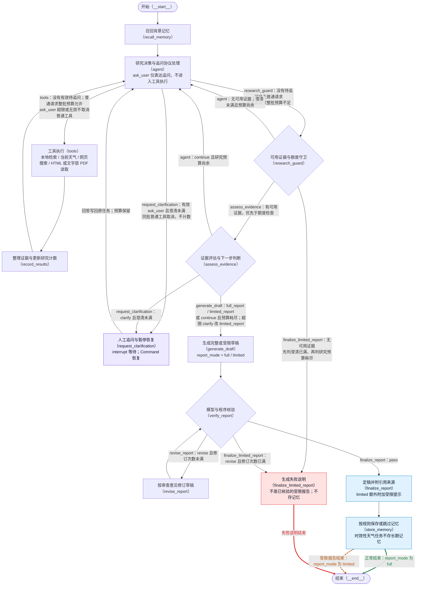

# 当前研究流程图

本图以 `graph.py` 实际注册的节点、固定边和条件边为准。先通过 `build_research_graph().get_graph().draw_mermaid()` 离线生成骨架，再补充中文标签和路由条件；构图没有执行 `invoke`，不调用模型或外部 API。

## 完整流程



绿色实线表示完整报告正常结束，橙色虚线表示受限报告结束，红色实线表示失败说明结束。完整、受限报告共用 `finalize_report → store_memory → END`；图中把最后一条固定边按结果画成两条彩色展示线，**不是新增条件边或路由函数**。实际只有一个 `__end__`。`__start__`、`__end__` 是 LangGraph 骨架中的内置节点 ID，其余 13 个 ID 均为主图注册名称。

## 分支含义与先后顺序

| 分流位置 | 当前实现 |
| --- | --- |
| `agent` 的追问处理 | `ask_user` 声明绑定给模型但不在四个研究工具的执行列表内。有效且额度未满时，在 `agent` 为本批每个请求补一条 `ToolMessage`；追问回应为“等待用户，非回答；已转交人工澄清流程”，普通工具回应为取消，均不产生证据或计入研究预算。多个有效追问合并为一次。 |
| `route_after_agent` | 先检查待追问且澄清未满，再检查普通工具和批次预算。超限时只拒绝 `ask_user`；参数无效时回错误消息、不暂停；这两种情况同批普通工具照常走预算，预算不足或没有普通请求才去守卫。`tools` 按调用 ID 跳过已回应请求，误入执行层的 `ask_user` 也只安全报错。 |
| `route_after_research_guard` | 先判断有无 `usable_evidence`，有则评估；无则先检查澄清上限，再检查研究预算，任一满足进入失败说明，否则回 `agent`。守卫在“澄清已满且无可用证据”时不增加研究轮次；其他无证据尝试会加一轮，再由路由判断预算。 |
| `assess_evidence` 的澄清处理 | 与 `agent` 共用已完成问答历史。模型若返回 `clarify` 但额度已满，评估节点程序覆盖为 `sufficient=False, next_step=limited_report`，清除待追问并记录上限事件；不是无证据失败说明。 |
| `route_after_evidence_assessment` | `clarify` 未满去追问、已满去草稿（路由额外防守）；`full_report / limited_report` 去草稿；其余 `continue` 在预算耗尽时去草稿，否则回 `agent`。评估入口要求有可用证据。 |
| `generate_draft` 的报告模式 | 只有 `sufficient=True` 且 `next_step=full_report` 才是 `full`，其他为 `limited`。二者都必须核验；受限报告在定稿时由程序加“当前证据不全”提示。 |
| `route_after_report_verification` | 使用程序规范化后的 verdict：`pass` 定稿；`revise` 且已修订少于 2 次则修订并再核验；已修订 2 次仍有必须修改项则进入失败说明，不交付未经核验的草稿。引用完整性和简要正文长度问题仍是程序硬检查。 |
| 两类交付 | `finalize_report` 交付核验通过的完整或受限报告；非时效性任务的两种报告都可保存为带 `report_mode` 的记忆，当前天气任务或证据包含天气结果时跳过存储。`finalize_limited_report` 生成核验失败、无可用证据或异常状态的失败说明，直接结束，不经过记忆；澄清上限原因不写成预算耗尽。 |

图上条件边标签的冒号前是路由函数真实返回值，冒号后是判断依据；`pass / revise`、`clarify / continue / full_report / limited_report` 是相应结构化判断字段，不是独立业务节点。未捕获异常和图递归上限异常不属于注册的结束分支，本图不将它们画成正常交付。

## 核验分级、复查与交付

核验提示词区分两类问题：

- **必须修改项**：编造证据中没有的事实或来源、与证据明确矛盾、引用编号不存在或与文字错配、数字／单位／时间错误、同一事实的证据冲突未说明。模型应把可执行修改动作写入 `required_changes`，每项附证据原句及上下文。
- **建议项**：措辞偏强、选择性引用、综合推断偏强或可补充的限定，写入 `unsupported_or_overstated_claims` 并以 `[建议]` 开头；提示词要求不得仅因此判为 `revise`，不写入 `required_changes`。用户陈述与证据的差异也按建议处理，不能称为证据之间的冲突。

上述语义分级由模型按提示词完成，不是程序独立核实每一句话。程序另检查引用是否存在／是否完全缺引用，以及简要正文是否超出 900 字符；发现问题会追加必须修改项。最后统一按 `required_changes` 是否为空确定 verdict：非空为 `revise`，为空为 `pass`。若与模型原值不同，记录 `review_verdict_normalized`，保留原值、最终值和必须修改项数量。

首次核验不附上次审查。修订次数大于 0 且存在 `report_review` 时，复查输入附上最近一次审查的 verdict、required_changes、reason，并注明草稿已按必须修改项修订。提示词要求复查只确认旧必须修改项是否改到位、修订是否新引入必须修改项，不重新审计既有建议或要求恢复已删除措辞。当前输入没有单独传入上次建议清单，复查边界仍依赖提示词和模型遵守，程序没有建议项逐项比对器。

修订输入包含当前草稿和最近一次完整审查。提示词要求只执行必须修改项，不因建议改动正文，并在全文定位同一主张的所有位置后保持一致。建议保存在审查结果中，debug 在报告之外展示“必须修改 N 条，建议 M 条”及审查清单；定稿程序不会把这些清单追加到正文，也没有逐句删除模型正文中建议内容的过滤器。

`full` 与 `limited` 都必须通过核验。`limited` 定稿时，程序在正文开头添加：

> 受限报告：当前证据不全，本报告仅包含被证据支持的部分；未解决问题见正文。

核验通过的非时效性受限报告也可保存为项目记忆，记录 `report_mode=limited`，状态仍为 `verified_report`；以后注入 Agent 背景时会加“证据不全，仅作线索，不可当作结论”。失败说明不存记忆，时效性天气任务也不存长期项目记忆。

## interrupt 与同任务恢复

`interrupt` 在 `request_clarification` 内，不在 `tools`。追问工具的协议回应已在 `agent` 关闭；暂停节点在 `interrupt` 前只读取并校验追问，不调用模型或工具、不写 State。用户回答后追加消息、问答历史，清空待追问和旧评估，沿固定边回 `agent`，不重走入口，不重置预算。

正式入口使用 `InMemorySaver`、同一图实例和不变的 `thread_id`，通过 `Command(resume=...)` 恢复。等待不标记任务完成，运行时长排除用户输入等待。检查点仅在进程内有效，进程退出后暂停任务不能恢复；这与跨运行的项目摘要记忆不是一回事。详见 [HITL 说明](HITL_minimal.md)。

## 程序额度

| 常量 | 当前值 | 用途 |
| --- | --- | --- |
| `MAX_RESEARCH_ROUNDS` | 4 | 一批实际工具结果记一轮；无证据守卫也可记空尝试，不是每进入一次 `agent` 都加一。 |
| `MAX_TOOL_CALLS` | 8 | 实际研究工具请求计数上限；整批放不下就不执行该批。 |
| `MAX_CLARIFICATIONS` | 2 | 两入口共用 `len(clarification_history)`，即已完成问答次数。 |
| `MAX_REPORT_REVISION_ROUNDS` | 2 | 草稿最多受控修订两次；每次修订后再次核验，仍有必须修改项则失败说明。 |
| `GRAPH_RECURSION_LIMIT` | 30 | 入口传入的图执行步数保护，不是研究轮数或追问次数。 |

研究预算在轮次或工具次数任一达到上限时耗尽；执行普通工具批次还要求轮次未满，且“已执行工具数 + 本批普通请求数”不超过 8。追问、控制回应和因澄清取消的工具不计数。`usable_evidence` 会排除过期或缺少可靠时间的天气记录；原始证据仍保留。

## read_source：HTML 与文字层 PDF

`read_source` 已支持有文字层的 PDF，依赖声明为 `pypdf>=5.0,<7.0`。URL 路径以 `.pdf` 结尾、下载内容以 `%PDF` 开头，或响应类型为 `application/pdf`，任一成立就进入 PDF 路径；即使后缀已经明确，也会先下载，再提取，而不再直接返回“不支持 PDF”。缺少 pypdf 时返回明确工具错误，不尝试自动安装。

PDF 当前限制为：文件 10MiB、最多处理前 30 页、提取文本最多 100000 字符；最终证据正文仍最多 12000 字符，包含截断范围说明。每页可用文本前有 `[第 N 页]`，空文本页跳过。结果记录总页数、已处理页范围、跳过页及最终保留的页码；页数或字符截断会明确说明。这里没有按相关度选段，前缀可能被封面和目录占用，不能据此声称已掌握整份长报告。

解析在独立子进程中执行，等待上限 15 秒，超时终止并回收子进程；不包括下载时间，也不是严格的内存隔离。疑似扫描版／无文字层、字体编码异常、过大、加密无法读取和解析异常有不同错误提示，不做 OCR。稀疏／乱码检测是启发式判断，并不保证识别所有问题。

失败结果附 PDF 判定依据、响应类型、下载字节数等元数据；不能取得响应时字节数可以未知，不记录正文或内容头原文。`tool_failed` 业务事件为 `error`，网页诊断在 debug Trace 中展示；节点正常处理了错误结果，其 `node_completed` 仍可为 `success`。失败调用照常消耗工具预算。

## --debug 诊断材料

正式命令加 `--debug`，运行到图结束后，将本次诊断材料写入：

`docs/validation/<日期>/<run_id>/`

保存每版草稿 `draft_XX.md`、每次完整审查 `review_XX.json`、带证据编号／来源／已有时间字段的 `evidence.json`、最终报告 `final_report.md` 和含 Trace 的终端格式输出 `final_output.txt`。旧草稿与审查来自本次内存检查点历史；证据保存原始记录，不因过期过滤而删除或重编号。审查 JSON 仍沿用现有字段。

`docs/validation/` 已在 `.gitignore` 中。debug 入口在研究开始前检查忽略规则，保存前再次确认；未确认忽略则停止，不自行修改规则。这是结束后保存，不是实时落盘检查点；无回答接收器时返回暂停结果，不会保存一套“已结束”的诊断材料，也不能靠这些文件恢复退出进程的任务。

## 生成版本与复现

依据代码提交：`1ee282a4aacfbec6d1478ea774f3ff017c80f8bf`（核对日期：2026-10-22）。本次仅更新两份架构说明，不修改业务实现。

在项目根目录执行以下命令可重新生成原始 Mermaid 骨架，只打印文本，不执行研究、不联网：

```powershell
.venv\Scripts\python -c "from atmospheric_research_agent.agent.graph import build_research_graph; print(build_research_graph().get_graph().draw_mermaid())"
```

原始骨架不会包含本页人工补充的中文、条件说明和三类交付配色。更新图时需重新核对四个路由函数及节点内澄清预处理；本页整理图保留实际注册节点和边；README 未在本次任务中修改。本机未找到 `mmdc`，未做渲染验证；已人工检查引号、节点 ID、边标签及样式索引，并离线核对节点和边与生成骨架一致（末尾固定结束边的双色展示去重后核对）。
