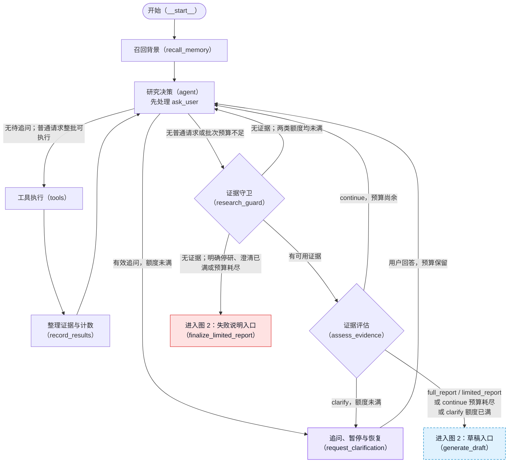
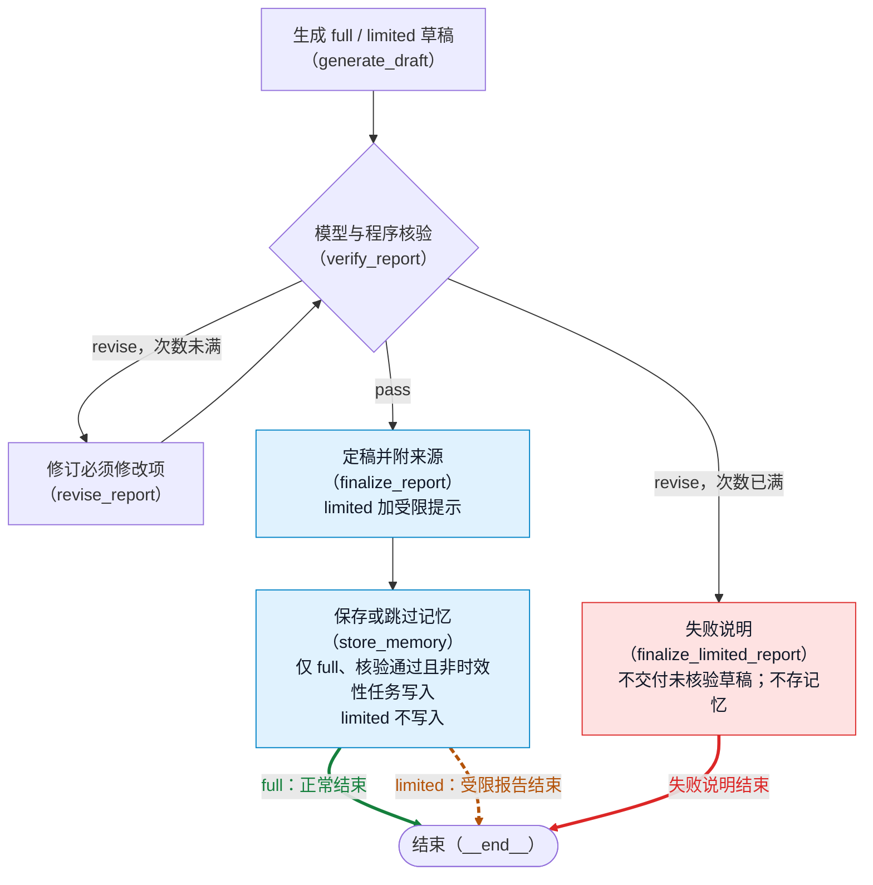

# 当前研究流程图

本图以 `graph.py` 实际注册的节点、固定边和条件边为准。先通过 `build_research_graph().get_graph().draw_mermaid()` 离线生成骨架，再补充中文标签和路由条件；构图没有执行 `invoke`，不调用模型或外部 API。

## 分段流程

### 图 1：研究与追问



图 1 的两个出口沿用真实节点 ID：`generate_draft` 对应图 2 的草稿入口，`finalize_limited_report` 对应图 2 的失败说明入口，不是新增节点。`tools` 合并执行四个研究工具：本地检索、当前天气、网页搜索、HTML／文字层 PDF 读取；`ask_user` 不在其中。有效追问优先；超限或参数无效的追问不取消同批普通工具，普通工具仍检查预算。

### 图 2：报告核验与结束



绿色实线为 full 正常结束，橙色虚线为 limited 受限报告结束，红色实线为失败说明结束。full 与 limited 共用 `finalize_report → store_memory → END`；双色结束线仅展示结果区别，不是新增路由。limited 经过记忆节点但跳过写入，失败说明不经过记忆节点。

两张图合计覆盖全部 13 个业务节点，衔接节点在两图重复展示。实际只有一个 `__end__`。`__start__`、`__end__` 是 LangGraph 内置节点 ID。图 1 中守卫先检查可用证据，无证据时才检查澄清及研究预算；Agent 侧追问超限只拒绝控制请求，评估侧超限 clarify 则降级为 limited 草稿。

## 分支含义与先后顺序

| 分流位置 | 当前实现 |
| --- | --- |
| `agent` 的追问处理 | `ask_user` 声明绑定给模型但不在四个研究工具的执行列表内。有效且额度未满时，在 `agent` 为本批每个请求补一条 `ToolMessage`；追问回应为“等待用户，非回答；已转交人工澄清流程”，普通工具回应为取消，均不产生证据或计入研究预算。多个有效追问合并为一次。 |
| `route_after_agent` | 先检查待追问且澄清未满，再检查普通工具和批次预算。超限时只拒绝 `ask_user`；参数无效时回错误消息、不暂停；这两种情况同批普通工具照常走预算，预算不足或没有普通请求才去守卫。`tools` 按调用 ID 跳过已回应请求，误入执行层的 `ask_user` 也只安全报错。 |
| `route_after_research_guard` | 先判断有无 `usable_evidence`，有则评估；无则先检查澄清上限，再检查研究预算，任一满足进入失败说明，否则回 `agent`。守卫在“澄清已满且无可用证据”时不增加研究轮次；其他无证据尝试会加一轮，再由路由判断预算。有可用证据、上次评估要求 `continue`、随后 `agent` 无工具（含无效 JSON、空回复），且预算尚未耗尽时，守卫把这次空转计为一轮并记录 `idle_round_counted`；刚整理过实际工具结果的批次不会重复计次。 |
| `assess_evidence` 的澄清处理 | 与 `agent` 共用已完成问答历史。模型若返回 `clarify` 但额度已满，评估节点程序覆盖为 `sufficient=False, next_step=limited_report`，清除待追问并记录上限事件；不是无证据失败说明。 |
| `route_after_evidence_assessment` | `clarify` 未满去追问、已满去草稿（路由额外防守）；`full_report / limited_report` 去草稿；其余 `continue` 在预算耗尽时去草稿，否则回 `agent`。评估入口要求有可用证据；预算耗尽后模型仍返回 `continue` 时，评估节点先由程序规范化为 `sufficient=False, next_step=limited_report`，记录 `assessment_next_step_normalized`，再进行路由。 |
| `generate_draft` 的报告模式 | 只有 `sufficient=True` 且 `next_step=full_report` 才是 `full`，其他为 `limited`。二者都必须核验；受限报告在定稿时由程序加“当前证据不全”提示。 |
| `route_after_report_verification` | 使用程序规范化后的 verdict：`pass` 定稿；`revise` 且修订次数未达 `MAX_REPORT_REVISION_ROUNDS` 则修订并再核验；达到上限仍有必须修改项则进入失败说明，不交付未经核验的草稿。引用完整性和简要正文长度问题仍是程序硬检查。 |
| 两类交付 | `finalize_report` 交付核验通过的完整或受限报告；只有明确为 `full`、核验通过且非时效性的任务才写入长期记忆。`limited` 跳过存储，当前天气任务或原始证据包含天气结果时也跳过。`finalize_limited_report` 生成核验失败、无可用证据或异常状态的失败说明，直接结束，不经过记忆；澄清上限原因不写成预算耗尽。 |

图上条件边只标判断依据，目标节点 ID 对应路由函数的真实返回值；`pass / revise`、`clarify / continue / full_report / limited_report` 是结构化判断字段，不是独立业务节点。固定边上的说明不表示新增条件路由。未捕获异常和图递归上限异常不属于注册的结束分支，本图不将它们画成正常交付。

## 核验分级、复查与交付

核验提示词区分两类问题：

- **必须修改项**：编造证据中没有的事实或来源、与证据明确矛盾、引用编号不存在或与文字错配、数字／单位／时间错误、同一事实的证据冲突未说明。模型应把可执行修改动作写入 `required_changes`，每项附证据原句及上下文。
- **建议项**：措辞偏强、选择性引用、综合推断偏强或可补充的限定，写入 `unsupported_or_overstated_claims` 并以 `[建议]` 开头；提示词要求不得仅因此判为 `revise`，不写入 `required_changes`。用户陈述与证据的差异也按建议处理，不能称为证据之间的冲突。

上述语义分级由模型按提示词完成，不是程序独立核实每一句话。程序另检查引用是否存在／是否完全缺引用，以及简要正文是否超出 900 字符；发现问题会追加必须修改项。最后统一按 `required_changes` 是否为空确定 verdict：非空为 `revise`，为空为 `pass`。若与模型原值不同，记录 `review_verdict_normalized`，保留原值、最终值和必须修改项数量。

首次核验不附上次审查。修订次数大于 0 且存在 `report_review` 时，复查输入附上最近一次审查的 verdict、required_changes、reason，并注明草稿已按必须修改项修订。提示词要求复查只确认旧必须修改项是否改到位、修订是否新引入必须修改项，不重新审计既有建议或要求恢复已删除措辞。当前输入没有单独传入上次建议清单，复查边界仍依赖提示词和模型遵守，程序没有建议项逐项比对器。

修订输入包含当前草稿和最近一次完整审查。提示词要求只执行必须修改项，不因建议改动正文，并在全文定位同一主张的所有位置后保持一致。建议保存在审查结果中，debug 在报告之外展示“必须修改 N 条，建议 M 条”及审查清单；定稿程序不会把这些清单追加到正文，也没有逐句删除模型正文中建议内容的过滤器。

`full` 与 `limited` 都必须通过核验。`limited` 定稿时，程序在正文开头添加：

> 受限报告：当前证据不全，本报告仅包含被证据支持的部分；未解决问题见正文。

受限报告的写作提示要求每个证据缺口只写一次：已有证据的内容解释清楚，缺失内容集中放在局限性一节，不在结论、解释和局限中反复写同一条“无法判断”。这是提示词约束，没有单独的程序去重器。

`store_memory` 只保存明确为 `report_mode=full`、审查为 `pass`、且非时效性任务的最终报告；原始证据中含天气结果时也跳过。`limited` 一律记录 `memory_skipped`，原因是“受限报告证据不全，不写入长期记忆”。历史库中已有的 limited 记录仍兼容召回，注入 Agent 背景时加“证据不全，仅作线索，不可当作结论”；这不表示当前仍会新增此类记录。失败说明不经过记忆节点，不存长期记忆。

核验模型使用 `json_mode`。可选环境变量 `VERIFY_THINKING` 未设置或为 `disabled` 时保持关闭，为 `enabled` 时只对核验模型开启；其他取值报错。Agent、评估、写作和修订仍关闭 thinking。核验事件记录开关状态和模型调用耗时，不保存隐藏的 `reasoning_content`。调用出错时保留原始异常并附本次配置说明，不静默回退；是否支持该组合仍取决于实际服务端。

## 事件取证与用户陈述

针对指定日期和地点的天气事件，Agent 提示要求先核实时间、地点、实测量级和影响范围，再用本地知识库解释机制。网页搜索只生成候选，取得网页证据还需读取正文；尚缺事件事实时，先读取其他候选或换检索词找实况，不把剩余研究轮次优先用于一般机制。优先读取官方气象机构发布、实况通报和同行评审论文；只有导航或栏目的页面视为无效来源。确认找不到实况后，才转向机制解释。

预报、实况或事后分析、一般机制背景须区分性质；不能把预报写成实况，或把邻近地区资料写成目标地点资料。评估提示要求：只有机制背景、缺少事件事实时，`sufficient=False`，并在 `missing_points` 写明“缺少事件事实”；只有预报而没有实况也须指出。

用户补充属于用户陈述，不是正式证据：不能标 E 编号或写成已核实事实；与证据不一致时，写“用户陈述与证据不一致，无法核实”并列入局限性，不称为证据之间的分歧。不同正式证据对同一时间、数值或名称不一致时，写作和修订提示要求明写分歧、分别标注引用，不择一隐去，也不自行判断孰是孰非。这些是模型提示约束，不是独立的程序事实认证器。

## interrupt 与同任务恢复

Agent 的无工具协议除 `assess` 外，还接受带非空 `stop_reason` 的 `decision=stop`，明确停止进一步取证；理由保存在 `research_stop_reason`，不是正式证据。无可用证据时，守卫直接进入失败说明，不再消耗空研究轮次；有证据时仍进入评估，评估若要求 `continue` 则程序规范化为 `limited_report`，草稿仍须核验。停止理由留在 State 与 Trace，失败正文只陈述程序确认的工具执行及取证结果，不直接复述模型理由，也不把停研称为预算耗尽。提示词禁止仅凭地名陌生或尚未找到资料就停研；这部分目标有效性判断仍依赖模型，不是地名存在性验证器。

各模型阶段收到程序提供的 UTC 与北京时间。默认每次调用读取实际时钟；Python 入口可显式传入带时区的 `reference_time` 用于固定资料回放，天气有效性检查使用同一时间基准，不从问题文字自动推断回放时钟，也不以 `started_at` 代替当前时间。无可用证据的失败说明会区分已过期、有效时间无法确认与时间晚于基准的天气记录，不把旧天气数值写成当前天气。

明确要求“一句话”时，草稿正文采用单句，不套用默认三章节结构，必要限定与引用放在同一句中，资料来源仍由程序另附。程序检查多句、分节、列表及多段等格式问题，发现后通过现有修订预算要求修改，不直接截断正文；这不是完整的自然语言语法分析器。

`interrupt` 在 `request_clarification` 内，不在 `tools`。追问工具的协议回应已在 `agent` 关闭；暂停节点在 `interrupt` 前只读取并校验追问，不调用模型或工具、不写 State。用户回答后追加消息、问答历史，清空待追问和旧评估，沿固定边回 `agent`，不重走入口，不重置预算。

正式入口使用 `InMemorySaver`、同一图实例和不变的 `thread_id`，通过 `Command(resume=...)` 恢复。等待不标记任务完成，运行时长排除用户输入等待。检查点仅在进程内有效，进程退出后暂停任务不能恢复；这与跨运行的项目摘要记忆不是一回事。详见 [HITL 说明](HITL_minimal.md)。

## 程序额度

| 常量 | 当前值 | 用途 |
| --- | --- | --- |
| `MAX_RESEARCH_ROUNDS` | 4 | 一批实际工具结果记一轮；无证据守卫也可记空尝试；有证据且评估要求继续后的无工具空转按上述条件计一轮，不是每进入一次 `agent` 都加一。 |
| `MAX_TOOL_CALLS` | 8 | 实际研究工具请求计数上限；整批放不下就不执行该批。 |
| `MAX_CLARIFICATIONS` | 2 | 两入口共用 `len(clarification_history)`，即已完成问答次数。 |
| `MAX_REPORT_REVISION_ROUNDS` | 2 | 草稿最多受控修订两次；每次修订后再次核验，仍有必须修改项则失败说明。 |
| `GRAPH_RECURSION_LIMIT` | 40 | 入口传入的图执行步数保护，不是研究轮数或追问次数。 |

以上当前值从 `agent/settings.py` 的同名常量核对；实际限制由程序常量决定，不由文档或模型决定。研究预算在轮次或工具次数任一达到上限时耗尽；执行普通工具批次还要求轮次未满，且“已执行工具数 + 本批普通请求数”不超过 `MAX_TOOL_CALLS`。追问、控制回应和因澄清取消的工具不计数。`usable_evidence` 会排除过期或缺少可靠时间的天气记录；原始证据仍保留。

`settings.py` 的递归保护注释按无追问入口或追问恢复入口各 1 步、4 轮各 6 步、报告阶段 4 + 2 × 2 = 8 步核算，最长合法路径为 33 步；加约 20% 余量得到 39.6，取 40。修改研究轮次、修订上限或图结构时必须重新核算。

Agent 系统上下文传入按常量减当前计数计算的剩余研究轮次、剩余工具调用，最低为零，并说明本批请求不能超过剩余工具次数，否则整批不执行；任一剩余量为零时不要再发起研究工具调用。评估人消息不再传入两行原始计数，而是复用 `research_budget_exhausted` 给出“研究预算：可以继续检索。”或“研究预算：已耗尽，不得选择 continue。”；澄清额度仍单独给出可否追问的状态句。提示词要求评估的 `reason` 不描述预算／额度，程序路由不以该自由解释作判断。

## read_source：HTML 与文字层 PDF

`read_source` 已支持有文字层的 PDF，依赖声明为 `pypdf>=5.0,<7.0`。URL 路径以 `.pdf` 结尾、下载内容以 `%PDF` 开头，或响应类型为 `application/pdf`，任一成立就进入 PDF 路径；即使后缀已经明确，也会先下载，再提取，而不再直接返回“不支持 PDF”。缺少 pypdf 时返回明确工具错误，不尝试自动安装。

PDF 限制由 `agent/settings.py` 的 `PDF_MAX_BYTES`（10MiB）、`PDF_MAX_PAGES`（30 页）、`PDF_MAX_EXTRACTED_CHARACTERS`（100000 字符）和 `PDF_PARSE_TIMEOUT_SECONDS`（15 秒）决定；最终证据正文仍受 `MAX_SOURCE_CHARACTERS`（12000 字符）限制，包含截断范围说明。每页可用文本前有 `[第 N 页]`，空文本页跳过。结果记录总页数、已处理页范围、跳过页及最终保留的页码；页数或字符截断会明确说明。这里没有按相关度选段，前缀可能被封面和目录占用，不能据此声称已掌握整份长报告。

解析在独立子进程中执行，等待上限为 `PDF_PARSE_TIMEOUT_SECONDS`，超时终止并回收子进程；不包括下载时间，也不是严格的内存隔离。无可用文字或至少 80% 的已处理页少于 20 个字母／数字字符时，提示“疑似扫描版或无文字层，需要 OCR”；替换字符、异常控制字符的占比超过 2%，或 `(cid:` 至少出现 3 次且该前缀占比超过 2% 时，提示“字体编码异常，无法可靠提取”。阈值分别来自 `PDF_MIN_PAGE_TEXT_CHARACTERS`、`PDF_MAX_SPARSE_PAGE_RATIO`、`PDF_MAX_GARBLED_RATIO`、`PDF_MIN_CID_OCCURRENCES`。过大、加密无法读取和解析异常有不同错误提示，不做 OCR。这些是启发式判断，并不保证识别所有问题。

PDF 来源标题优先采用有效元数据标题；为空或像文件名／网址时显示为“PDF：域名”。空作者及 `user`、`admin` 等通用作者值不显示。这仅整理来源展示，不改变正文提取。

失败结果附 PDF 判定依据、响应类型、下载字节数等元数据；不能取得响应时字节数可以未知，不记录正文或内容头原文。`tool_failed` 业务事件为 `error`，网页诊断在 debug Trace 中展示；节点正常处理了错误结果，其 `node_completed` 仍可为 `success`。失败调用照常消耗工具预算。

## --debug 诊断材料

正式命令加 `--debug`，在研究开始时建立本次诊断目录：

`docs/validation/<日期>/<run_id>/`

节点执行期间，节点名、步序号与执行事件实时追加到 `node_trace.jsonl`。首次调用与追问恢复调用均捕获 `GraphRecursionError`；超限时读取当前检查点，保存 `recursion_error.json` 与 `trace.json`，包括节点序列、研究轮次、工具次数、澄清已用次数与报告修订次数。CLI 输出“流程超过步数上限被中止”的中文说明，退出码非 0；这不属于图内正常报告交付。

正常运行到图结束后，保存每版草稿 `draft_XX.md`、每次完整审查 `review_XX.json`、带证据编号／来源／已有时间字段的 `evidence.json`、最终报告 `final_report.md` 和含 Trace 的终端格式输出 `final_output.txt`。旧草稿与审查来自本次内存检查点历史；证据保存原始记录，不因过期过滤而删除或重编号。审查 JSON 仍沿用现有字段。

`docs/validation/` 已在 `.gitignore` 中。debug 入口在研究开始前检查忽略规则，保存前再次确认；未确认忽略则停止，不自行修改规则。实时节点日志和超限诊断不是可跨进程恢复的检查点；无回答接收器时返回暂停结果，不会保存一套“已结束”的诊断材料，也不能靠这些文件恢复退出进程的任务。其他未捕获异常不保证生成完整结束材料。

## 生成版本与复现

依据代码提交：`f005e86`（核对日期：2026-10-23）。本图拆为研究与追问、报告核验与结束两段，README 同步使用这两张图，不修改业务实现。

在项目根目录执行以下命令可重新生成原始 Mermaid 骨架，只打印文本，不执行研究、不联网：

```powershell
.venv\Scripts\python -c "from atmospheric_research_agent.agent.graph import build_research_graph; print(build_research_graph().get_graph().draw_mermaid())"
```

原始骨架不会包含本页人工补充的中文、条件说明和三类交付配色。更新图时需重新核对四个路由函数及节点内澄清预处理；本页两图合并、去除重复衔接节点和双色结束展示边后，节点及边与生成骨架一致。README 使用相同两图。本机未找到 `mmdc`，未做渲染验证；已人工检查引号、节点 ID、边标签及样式索引，并离线核对节点和边。
